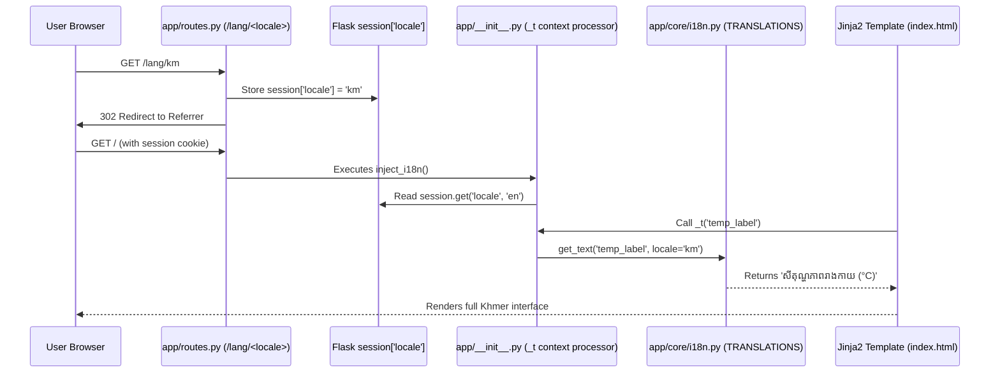

# Production Documentation: Clinical Triage Expert System

**Project Title:** Modular Clinical Triage Advisor  
**Author:** Principal AI Engineer & System Architect  
**Architecture Paradigm:** Clean Architecture • Production Rule-Based Expert System (Forward-Chaining)  
**Target Environment:** Python 3.10+ / Flask / Pytest  
**Internationalization:** Bilingual English (`en`) & Khmer (`km`) Pure-Python Architecture  

---

## 1. Executive Summary & Overview

### 1.1 The Clinical Problem
In emergency departments, outpatient urgent care clinics, and telehealth entry points, **triage** is the critical first stage of patient evaluation. Clinicians must rapidly evaluate presenting vital signs (core temperature, respiratory distress, cough severity, symptom duration, oxygen saturation) and stratify patients into risk categories to allocate limited medical resources and prevent avoidable mortality.

Subjective variability, clinical fatigue, and cognitive overload often lead to inconsistent triage decisions. The **Clinical Triage Advisor** provides a deterministic, transparent, and auditable decision-support system that standardizes acuity assessment while maintaining 100% explainability for clinical and legal compliance.

---

### 1.2 System Design Paradigm: Architectural Comparison
Why build an **Expert System** for clinical triage rather than a tabular lookup table or a deep Machine Learning (ML) model? The table below highlights the architectural trade-offs:

| Criterion | Rule-Based Expert System (This System) | Static Lookup / Decision Matrix | Machine Learning / Neural Network |
| :--- | :--- | :--- | :--- |
| **Reasoning Model** | **Forward-Chaining Inference**: Iteratively derives abstract clinical concepts from raw biometric facts across multiple cycles. | **Static Key-Value Matching**: Direct mapping from predefined discrete keys to single outcomes. | **Statistical Correlation**: Latent feature representations learned from training datasets. |
| **Explainability (XAI)** | **100% Transparent**: Complete step-by-step audit trace detailing which rules fired, which failed, and the exact mathematical predicates evaluated. | **Partial / Rigid**: Can show which table row was matched, but lacks deduction chains or multi-factorial synthesis. | **Black-Box**: Opaque weight matrices; post-hoc explainers (SHAP/LIME) provide approximations, not guarantees. |
| **Domain Safety & Verification** | **Deterministic & Provable**: Formally verified through boundary value unit tests and priority ordering; no hallucination risk. | **Fragile to Combinatorial Explosion**: Fails or requires exponential row explosion as variables increase. | **Probabilistic Risk**: Prone to edge-case hallucinations, dataset distribution shift, and silent catastrophic failures. |
| **Conflict Resolution** | **Hierarchical Acuity Protocol**: Mathematical resolution ($Emergency > Urgent > Moderate > Low$) with explicit conflict documentation. | **Arbitrary / Hardcoded**: First-match or last-match wins without dynamic conflict reasoning. | **Softmax Probability**: Selects highest probability class, which may overlook low-probability but fatal conditions. |
| **Data Requirements** | **Zero Training Data Needed**: Formally encodes established clinical heuristics (WHO, CDC, triage protocols). | Minimal data; requires exhaustive combination grids. | Requires thousands of balanced, annotated, high-quality patient records. |
| **Regulatory & Audit Readiness** | **Medical Device Compliant**: Meets FDA/MDR requirements for transparent Software as a Medical Device (SaMD). | High auditability, but poor clinical flexibility. | High regulatory barrier; complex validation and bias auditing required. |

---

## 2. Project Architecture & Directory Layout

### 2.1 Full Directory Layout

```
expert_system_flask/
├── .gitignore                      # Git exclusion rules (bytecode, pytest, virtualenv)
├── README.md                       # Quickstart summary & project overview
├── DOCUMENTATION.md                # Comprehensive architectural and technical specification
├── requirements.txt                # Python package manifests (Flask, Pytest)
├── run.py                          # Application entry point for development/production boot
├── config.py                       # Layered environment configuration (Dev, Test, Prod)
├── app/
│   ├── __init__.py                 # Flask Application Factory pattern with i18n context processor
│   ├── routes.py                   # HTTP routing: Web views, REST API, /lang/<locale> switcher
│   ├── core/                       # PURE DOMAIN LOGIC (Zero web/external framework dependencies)
│   │   ├── __init__.py             # Public domain package exports
│   │   ├── i18n.py                 # Pure-Python bilingual dictionary mapping (English & Khmer)
│   │   ├── models.py               # Domain dataclasses with bilingual getters (en/km)
│   │   ├── rules.py                # Knowledge Base: Bilingual IF-THEN clinical rules
│   │   └── engine.py               # Inference Engine: Forward chaining & conflict resolution
│   ├── static/
│   │   ├── css/
│   │   │   └── style.css           # Modern clinical CSS with bilingual typography & badges
│   │   └── js/
│   │       └── main.js             # Client interactivity: Presets, live SpO2 alerts, audit filters
│   └── templates/
│       ├── base.html               # Semantic HTML5 base shell with bilingual toggle (🇺🇸/🇰🇭)
│       └── index.html              # Diagnostic form, risk badges, working memory, & audit trail
└── tests/
    ├── __init__.py                 # Test package initialization
    ├── test_rules.py               # Unit tests: Predicate conditions and boundary edge values
    ├── test_engine.py              # Unit tests: Forward-chaining cycles, conflict resolution, fallback
    └── test_routes.py              # Integration tests: HTTP GET/POST, /lang/<locale>, and REST contracts
```

---

### 2.2 Component Responsibility & Separation of Concerns

The architecture strictly adheres to **Robert C. Martin's Clean Architecture** (Hexagonal/Ports-and-Adapters). The core business rules have **no knowledge of the delivery mechanism** (HTTP, JSON, HTML).

```
   ┌────────────────────────────────────────────────────────┐
   │                  Web Delivery Layer                    │
   │      (Flask routes.py, Jinja2 Templates, Static JS)     │
   └───────────────────────────┬────────────────────────────┘
                               │ calls
                               ▼
   ┌────────────────────────────────────────────────────────┐
   │             Inference Engine Orchestrator              │
   │               (app/core/engine.py)                     │
   └───────────────┬────────────────────────┬───────────────┘
                   │ uses                   │ evaluates
                   ▼                        ▼
   ┌──────────────────────────────┐  ┌──────────────────────┐
   │        Working Memory        │  │    Knowledge Base    │
   │ (app/core/models.py - Fact)  │  │ (app/core/rules.py)  │
   └──────────────────────────────┘  └──────────────────────┘
                   │                        │
                   └──────────┬─────────────┘
                              ▼
               ┌──────────────────────────────┐
               │   Bilingual i18n Subsystem   │
               │     (app/core/i18n.py)       │
               └──────────────────────────────┘
```

#### 1. Core Reasoning Layer (`app/core/`)
- **Independent of Web Frameworks**: Contains no Flask imports. Can be tested, benchmarked, or integrated into a CLI, mobile app, or background queue.
- **`models.py`**: Declares strongly-typed immutable entities (`Priority`, `Fact`, `Rule`, `Deduction`, `AuditEntry`, `InferenceResult`) with bilingual accessors.
- **`rules.py`**: Declarative knowledge repository containing 18 formal production rules with dual-language clinical text.
- **`engine.py`**: Controls rule firing, iterative fact derivation, conflict resolution, and execution tracing.
- **`i18n.py`**: Lightweight, pure-Python internationalization engine providing key-value string mappings for English and Khmer.

#### 2. Delivery & Presentation Layer (`app/`, `templates/`, `static/`)
- **`config.py`**: Encapsulates runtime profiles (`DevelopmentConfig`, `TestingConfig`, `ProductionConfig`).
- **`app/__init__.py`**: Implements the Application Factory (`create_app()`) and injects the `_t(key)` translation helper into the template context.
- **`app/routes.py`**: Normalizes HTTP inputs, handles language switching (`/lang/<locale>`), and exposes the REST API.
- **`templates/` & `static/`**: Clean, accessible presentation with clinical color coding and dual-language font support (`Kantumruy Pro` & `Inter`).

#### 3. Verification Suite (`tests/`)
- 34 automated pytest cases verifying rule boundaries, forward chaining, conflict resolution, HTTP routes, and bilingual locale switching.

---

## 3. Data Storage Architecture & Persistence Models

A fundamental architectural question in Expert Systems is: **Where is data stored?** In this system, data is divided across four distinct, purpose-built storage layers:

```
┌───────────────────────────────────────────────────────────────────────────┐
│                        DATA STORAGE ARCHITECTURE                          │
├─────────────────────────┬────────────────────────────┬────────────────────┤
│ Data Layer              │ Storage Medium / Location  │ Lifecycle / Scope  │
├─────────────────────────┼────────────────────────────┼────────────────────┤
│ 1. Working Memory       │ Python RAM Dictionary      │ Request-Scoped     │
│    (Patient Facts)      │ app/core/models.py         │ (Stateless)        │
├─────────────────────────┼────────────────────────────┼────────────────────┤
│ 2. Knowledge Base       │ Code-as-Data Objects       │ Application        │
│    (Clinical Rules)     │ app/core/rules.py          │ Lifetime           │
├─────────────────────────┼────────────────────────────┼────────────────────┤
│ 3. User Session         │ Cryptographic Cookie       │ Browser Session    │
│    (Selected Locale)    │ Flask session['locale']    │ (Client-Side)      │
├─────────────────────────┼────────────────────────────┼────────────────────┤
│ 4. i18n Dictionaries    │ Static Hash Map            │ Application        │
│    (Translations)       │ app/core/i18n.py           │ Lifetime           │
└─────────────────────────┴────────────────────────────┴────────────────────┘
```

### 3.1 Working Memory: Stateless In-Memory Fact Store
- **Implementation**: Managed in Python RAM by `WorkingMemory` ([`app/core/models.py`](file:///D:/HongBunleang/1_Norton/year3/Term1/4ExpertSystemDevelopment/ExportsystemTest/app/core/models.py#L76-L113)).
- **Mechanism**: Every POST request constructs a transient `WorkingMemory` instance holding an in-memory dictionary `_facts: Dict[str, Fact]`.
- **Privacy & HIPAA Compliance**: By retaining patient biometric observations **only during active inference** and releasing them immediately upon response delivery, the system avoids storing unencrypted Protected Health Information (PHI) to disk by default.

### 3.2 Knowledge Base: Code-as-Data
- **Implementation**: Declared in [`app/core/rules.py`](file:///D:/HongBunleang/1_Norton/year3/Term1/4ExpertSystemDevelopment/ExportsystemTest/app/core/rules.py#L21-L400) and instantiated via `get_knowledge_base()`.
- **Mechanism**: Rules are compiled Python objects containing predicate lambdas, priority weights, and bilingual deduction payloads. They execute directly in memory with microsecond latency without database overhead.

### 3.3 Session & Preferences: Signed Client-Side Cookie
- **Implementation**: Flask's secure session cookie: `session['locale']`.
- **Mechanism**: When a user switches to Khmer or English via `/lang/<locale>`, the selected language tag is cryptographically signed using `SECRET_KEY` and stored in the user's browser cookie.

### 3.4 Translation Data: Pure-Python In-Memory Hash Map
- **Implementation**: `TRANSLATIONS` dictionary in [`app/core/i18n.py`](file:///D:/HongBunleang/1_Norton/year3/Term1/4ExpertSystemDevelopment/ExportsystemTest/app/core/i18n.py#L14-L318).
- **Mechanism**: Resolves strings in $O(1)$ constant time with automatic fallback to English if a key is missing.

---

## 4. Core Expert System Mechanics (Deep Dive)

### 4.1 Working Memory & Fact Representation
Every observation is wrapped in a `Fact` dataclass with full provenance tracking:

```python
@dataclass
class Fact:
    name: str              # Unique identifier (e.g., 'temperature', 'has_high_fever')
    value: Any             # Typed value (float, int, bool, str)
    source: str = "input"  # Provenance: 'input' (raw biometric) or 'derived' (inferred by rule)
    description: Optional[str] = None
    created_at: str = ...  # ISO-8601 UTC timestamp
```

#### Clinical Variables in Working Memory
1. **Input Facts (Primitive Observations)**:
   - `temperature` (float): Core body temperature in Celsius (e.g., `36.5` - `41.5`).
   - `cough_severity` (str): Acuity categorization (`none`, `mild`, `moderate`, `severe`).
   - `respiratory_distress` (str): Work of breathing (`none`, `mild`, `moderate`, `severe`).
   - `duration_days` (int): Number of days symptoms have persisted.
   - `oxygen_saturation` (Optional[float]): Peripheral pulse oximetry $SpO_2$ percentage.
   - `chest_pain` (bool): Presence of new-onset pleuritic or substernal discomfort.
   - `lethargy_confusion` (bool): Altered mental status, stupor, or somnolence.
   - `high_risk_condition` (bool): Underlying comorbidity (COPD, immunosuppression, cardiac disease).

2. **Derived Facts (Inferred Concepts)**:
   - `has_fever` (bool): Inferred when $38.0^\circ\text{C} \le \text{temperature} < 39.0^\circ\text{C}$ or $\text{temperature} \ge 39.0^\circ\text{C}$.
   - `has_high_fever` (bool): Inferred when $\text{temperature} \ge 39.0^\circ\text{C}$.
   - `persistent_fever` (bool): Inferred when `has_fever == True` AND `duration_days >= 3`.
   - `has_hypoxia` (bool): Inferred when $SpO_2 < 92.0\%$.
   - `is_prolonged` (bool): Inferred when `duration_days >= 7`.

---

### 4.2 Knowledge Base (`app/core/rules.py`)

A `Rule` consists of:
1. **Rule ID & Bilingual Names**: Unique alphanumeric identifier (e.g., `R_EMERG_RESP_DISTRESS`) with English and Khmer titles.
2. **Predicate Condition**: A pure, side-effect-free lambda or callable `(WorkingMemory) -> bool`.
3. **Priority & Weight**: Explicit ordering in the triage hierarchy.
4. **Deduction Payload**: Clinical diagnosis, actionable advice list, and optional intermediate facts to assert in both English and Khmer.
5. **Intermediate Flag (`is_intermediate`)**: Distinguishes between deduction rules that build knowledge vs. terminal triage classifications.

#### Clinical Priority Scale:
```python
class Priority(IntEnum):
    INCONCLUSIVE = 1   # Baseline unclassified / atypical presentations
    LOW          = 2   # Common cold, mild upper airway illness, healthy vitals
    MODERATE     = 3   # Persistent fever (3+ days), subacute cough, mild URI
    URGENT       = 4   # High prolonged pyrexia (>= 39°C for 3+ days), suspected pneumonia
    EMERGENCY    = 5   # Impending respiratory failure, hyperpyrexia (>= 40.5°C), sepsis alert
```

#### Rule Hierarchy & Classification:

```
[Stage 1: Derivation Rules (Intermediate)]
   ├── R_DERIVE_HIGH_FEVER        -> Asserts has_high_fever=True
   ├── R_DERIVE_STANDARD_FEVER    -> Asserts has_fever=True
   ├── R_DERIVE_HYPOXIA           -> Asserts has_hypoxia=True
   ├── R_DERIVE_PERSISTENT_FEVER  -> Asserts persistent_fever=True
   └── R_DERIVE_PROLONGED_ILLNESS -> Asserts is_prolonged=True
         │ (asserts facts into working memory)
         ▼
[Stage 2-5: Terminal Triage Rules]
   ├── EMERGENCY (Priority 5)
   │     ├── R_EMERG_RESP_DISTRESS   (Severe dyspnea OR SpO2 < 92%)
   │     ├── R_EMERG_HYPERPYREXIA    (Temperature >= 40.5°C)
   │     ├── R_EMERG_SEPSIS_ALERT    (High fever/hypothermia + lethargy)
   │     └── R_EMERG_CARDIOPULMONARY (Chest pain + dyspnea/high fever)
   ├── URGENT (Priority 4)
   │     ├── R_URG_PROLONGED_HIGH_FEVER (has_high_fever + persistent_fever)
   │     ├── R_URG_PNEUMONIA_SUSPECT    (Fever + cough + moderate dyspnea)
   │     ├── R_URG_HIGH_RISK_FEBRILE    (Fever + high-risk comorbidity)
   │     └── R_URG_COMPLICATED_COUGH    (Severe cough >= 5 days + fever)
   ├── MODERATE (Priority 3)
   │     ├── R_MOD_PERSISTENT_FEVER     (has_fever + duration >= 3 days)
   │     ├── R_MOD_PROLONGED_COUGH      (Moderate/severe cough >= 7 days)
   │     └── R_MOD_FEBRILE_URI          (Fever + cough, duration < 3 days)
   └── LOW (Priority 2)
         ├── R_LOW_MILD_COLD            (Mild cough, no fever, duration < 7)
         └── R_LOW_HEALTHY_BASELINE     (Normal vitals, asymptomatic)
```

---

### 4.3 Inference Engine (`app/core/engine.py`)

The inference engine executes a **Forward-Chaining loop with Conflict Resolution**:

```mermaid
flowchart TD
    A[Raw Input Facts] --> B[Normalize & Type-Cast Facts]
    B --> C[Initialize WorkingMemory with source='input']
    C --> D[Start Inference Cycle: cycle = 1]
    D --> E[Iterate un-fired Rules in Knowledge Base]
    E --> F{Rule condition met?}
    F -- Yes --> G[Fire Rule: Log to Audit Trail]
    G --> H{Has new_facts to assert?}
    H -- Yes --> I[Assert derived facts to WorkingMemory with source='derived']
    H -- No --> J[Collect Deduction]
    I --> J
    F -- No --> K[Log condition failure to Audit Trail]
    J --> L{Any new rules fired in this cycle?}
    K --> L
    L -- Yes --> M{cycle < max_cycles?}
    M -- Yes --> N[cycle = cycle + 1] --> E
    M -- No --> O[Stabilized / Quiescence Reached]
    L -- No --> O
    O --> P{Any terminal triage rules matched?}
    P -- No --> Q[Apply Fallback INCONCLUSIVE Deduction]
    P -- Yes --> R[Conflict Resolution: Sort by Priority DESC, Weight DESC]
    R --> S[Winning Rule = terminal_rules[0]]
    Q --> T[Build Conflict Resolution Rationale]
    S --> T
    T --> U[Package & Return InferenceResult with Audit Trail]
```

#### Step-by-Step Cycle Trace:
1. **Cycle 1 (Concept Abstraction)**:
   - Evaluates Stage 1 derivation rules against raw input observations.
   - Example: A patient with `temperature = 39.4` and `duration_days = 4` satisfies `R_DERIVE_HIGH_FEVER` and `R_DERIVE_STANDARD_FEVER`.
   - `has_high_fever: True` and `has_fever: True` are asserted into Working Memory.
2. **Cycle 2 (Compound Derivation)**:
   - With `has_fever: True` now asserted, `R_DERIVE_PERSISTENT_FEVER` evaluates `has_fever == True and duration_days >= 3`.
   - The condition is satisfied; `persistent_fever: True` is asserted into Working Memory.
3. **Cycle 3 (Terminal Triage Evaluation)**:
   - Rule `R_URG_PROLONGED_HIGH_FEVER` checks `has_high_fever == True and persistent_fever == True`.
   - Both derived facts now exist in Working Memory; the rule fires and produces an `URGENT` deduction.
4. **Quiescence**:
   - In Cycle 4, no new rules fire. The engine detects stabilization and terminates the forward-chaining loop.

#### Conflict Resolution Strategy:
When symptoms satisfy multiple terminal rules (e.g., a patient qualifies for both `R_LOW_MILD_COLD` and `R_EMERG_RESP_DISTRESS` due to severe dyspnea), the engine applies a **Hierarchical Clinical Acuity Priority Filter**:
```python
terminal_rules.sort(
    key=lambda r: (int(r.priority), r.weight),
    reverse=True
)
winning_rule = terminal_rules[0]
```
The system documents the exact conflict in `conflict_resolution_notes` and `conflict_resolution_notes_km`, explaining that the Emergency rule was prioritized over lower-acuity rules in accordance with clinical safety guidelines.

#### Default Fallback Behavior:
If an unusual combination of vitals matches zero terminal rules (e.g. isolated temperature of 37.8°C with no other symptoms), the engine falls back safely to `INCONCLUSIVE` (Priority 1) with instructions to monitor symptoms and consult a physician if condition deteriorates.

---

### 4.4 Explainability & Audit Trail (XAI)
Every step of the reasoning process is captured in a bilingual `AuditEntry`:
```python
@dataclass
class AuditEntry:
    rule_id: str             # e.g., 'R_EMERG_RESP_DISTRESS'
    rule_name: str           # e.g., 'Emergency: Critical Respiratory Distress'
    rule_name_km: str        # Khmer title
    priority: str            # 'EMERGENCY'
    priority_value: int      # 5
    evaluated: bool          # True
    fired: bool              # True / False
    condition_repr: str      # "respiratory_distress == 'severe' OR has_hypoxia == True"
    reason: str              # "[Cycle 1] FIRED: Condition met"
    reason_km: str           # Khmer reason trace
    asserted_facts: dict     # {'has_hypoxia': True}
    diagnosis: Optional[str] # English diagnosis title
    diagnosis_km: Optional[str] # Khmer diagnosis title
    timestamp: str           # ISO-8601 UTC timestamp
```

---

## 5. Bilingual Subsystem (English & Khmer)

The application implements an ultra-lightweight, pure-Python internationalization architecture without third-party frameworks like Flask-Babel or GNU gettext.

### 5.1 Architecture & Flow



### 5.2 Key Internationalization Features
1. **Zero External Dependencies**: Does not require `gettext`, compiled `.mo` files, or OS-level locale packages.
2. **Model-Level Localized Getters**:
   - `result.final_deduction.get_diagnosis(current_locale)`
   - `result.final_deduction.get_action_advice(current_locale)`
   - `result.final_deduction.risk_level.get_label(current_locale)`
   - `entry.get_rule_name(current_locale)`
3. **Typography**: Incorporates Google Font **`Kantumruy Pro`** with optimized line heights (`1.65`) for Khmer typography.

---

## 6. API & Web Interface Reference

### 6.1 HTTP Endpoints

| Method | Endpoint | Description | Content-Type |
| :--- | :--- | :--- | :--- |
| `GET` | `/` | Renders the HTML Diagnostic Triage Form in current session language. | `text/html` |
| `POST` | `/` | Parses form fields, executes inference, and renders localized results with audit trail. | `application/x-www-form-urlencoded` |
| `GET` | `/lang/<locale>` | Switches language session to `'en'` or `'km'` and redirects to previous page. | `text/html` |
| `POST` | `/api/evaluate` | RESTful API endpoint returning complete JSON inference results. | `application/json` |
| `GET` | `/api/rules` | Returns the complete bilingual knowledge base rule catalog. | `application/json` |

---

### 6.2 REST API Specification: `POST /api/evaluate`

#### Request Headers:
```http
POST /api/evaluate HTTP/1.1
Host: 127.0.0.1:5000
Content-Type: application/json
Accept: application/json
```

#### Request Payload:
```json
{
  "temperature": 39.5,
  "duration_days": 4,
  "cough_severity": "moderate",
  "respiratory_distress": "none",
  "oxygen_saturation": 96.0,
  "chest_pain": false,
  "lethargy_confusion": false,
  "high_risk_condition": false
}
```

#### Response Body (HTTP 200 OK):
```json
{
  "status": "success",
  "data": {
    "final_deduction": {
      "risk_level": "URGENT",
      "risk_level_value": 4,
      "risk_label": "Urgent",
      "diagnosis": "Prolonged High-Grade Pyrexia (>= 39.0°C, >= 3 Days)",
      "diagnosis_km": "ក្តៅខ្លួនខ្លាំងអូសបន្លាយយូរថ្ងៃ (>= 39.0°C លើសពី ៣ ថ្ងៃ)",
      "action_advice": [
        "Urgent same-day clinical assessment by a physician is required (within 12-24 hours).",
        "Laboratory investigations needed: Complete Blood Count (CBC), CRP, ESR, and urinalysis.",
        "Maintain meticulous fluid intake and scheduled antipyretic dosing (paracetamol/ibuprofen)."
      ],
      "action_advice_km": [
        "ទាមទារការពិនិត្យវាយតម្លៃដោយគ្រូពេទ្យក្នុងថ្ងៃតែមួយ (ក្នុងរង្វង់ ១២ ទៅ ២៤ ម៉ោង)។",
        "ត្រូវធ្វើតេស្តមន្ទីរពិសោធន៍៖ វិភាគឈាមទូទៅ (CBC), CRP, ESR និងតេស្តទឹកនោម។",
        "រក្សាការពិសាជាតិទឹកឱ្យបានគ្រប់គ្រាន់ និងប្រើប្រាស់ថ្នាំបញ្ចុះកម្ដៅឱ្យបានត្រឹមត្រូវតាមកម្រិត។"
      ],
      "new_facts": {},
      "is_terminal": true
    },
    "matched_rules_count": 3,
    "matched_rule_ids": [
      "R_DERIVE_HIGH_FEVER",
      "R_DERIVE_PERSISTENT_FEVER",
      "R_URG_PROLONGED_HIGH_FEVER"
    ],
    "working_memory": {
      "temperature": {"name": "temperature", "value": 39.5, "source": "input"},
      "has_high_fever": {"name": "has_high_fever", "value": true, "source": "derived"},
      "persistent_fever": {"name": "persistent_fever", "value": true, "source": "derived"}
    },
    "conflict_resolution_notes": "Single triage rule 'R_URG_PROLONGED_HIGH_FEVER' (Urgent) fired without conflict.",
    "conflict_resolution_notes_km": "វិធានតែមួយ 'R_URG_PROLONGED_HIGH_FEVER' (បន្ទាន់ខ្លាំង) ត្រូវបានដំណើរការដោយគ្មានវិវាទ។",
    "execution_time_ms": 0.45,
    "audit_trail": [ ... ]
  }
}
```

---

## 7. Verification & Testing Strategy

The test suite consists of **34 automated pytest test cases** across three modules:

```
tests/
├── test_rules.py     # 15 tests: Isolated rule conditions and mathematical boundaries
├── test_engine.py    # 9 tests:  Forward chaining, conflict resolution, fallback, and serialization
└── test_routes.py    # 10 tests: Web form rendering, POST submissions, bilingual switching (/lang/), and REST API
```

### 7.1 Boundary Value Analysis (BVA)

| Clinical Variable | Test Values Evaluated | Expected Behavior |
| :--- | :--- | :--- |
| **High Fever Threshold** | `38.9°C` vs `39.0°C` | `38.9°C` fails high fever condition; `39.0°C` fires `R_DERIVE_HIGH_FEVER`. |
| **Standard Pyrexia Threshold** | `37.9°C` vs `38.0°C` | `37.9°C` fails fever condition; `38.0°C` fires `R_DERIVE_STANDARD_FEVER`. |
| **Hyperpyrexia Emergency** | `40.4°C` vs `40.5°C` | `40.4°C` does not trigger hyperpyrexia; `40.5°C` triggers `R_EMERG_HYPERPYREXIA`. |
| **Persistent Course** | `duration = 2` vs `3` days | `duration = 2` fails persistence; `duration = 3` fires `R_DERIVE_PERSISTENT_FEVER`. |
| **Prolonged Illness** | `duration = 6` vs `7` days | `duration = 6` fails prolonged course; `duration = 7` fires `R_DERIVE_PROLONGED_ILLNESS`. |
| **Hypoxia Boundary** | $SpO_2 = 92.0\%$ vs $91.9\%$ | $92.0\%$ is normal; $91.9\%$ triggers `R_DERIVE_HYPOXIA` and `R_EMERG_RESP_DISTRESS`. |

### 7.2 Conflict Resolution & Localization Tests
- **Emergency Priority**: Verifies that when facts satisfy symptoms for all acuity levels (Emergency, Urgent, Moderate), Emergency wins and both English and Khmer rationales are generated.
- **Bilingual Route Testing**:
  - `GET /lang/km` saves `'km'` in session, redirects, and verifies that Khmer headers, form fields, and triage banners render accurately.
  - `GET /lang/en` successfully toggles back to English.

---

## 8. Installation & Execution Guide

### 8.1 Prerequisites
- Python 3.10, 3.11, or 3.12.
- `pip` package manager.

### 8.2 Virtual Environment Setup & Installation

```bash
# 1. Clone repository and navigate to project root
cd expert_system_flask

# 2. Create virtual environment
python -m venv venv

# 3. Activate virtual environment
# Windows (PowerShell):
.\venv\Scripts\Activate.ps1
# Windows (CMD):
.\venv\Scripts\activate.bat
# Linux / macOS:
source venv/bin/activate

# 4. Install dependencies
pip install -r requirements.txt
```

---

### 8.3 Executing the Test Suite (34 Passing Tests)

Run pytest with verbose output:

```bash
pytest -v
```

Expected output:
```text
tests/test_engine.py::TestForwardChaining::test_forward_chaining_high_fever_and_persistent PASSED [  2%]
tests/test_engine.py::TestForwardChaining::test_forward_chaining_hypoxia_triggers_emergency PASSED [  5%]
tests/test_engine.py::TestConflictResolution::test_emergency_wins_over_urgent_and_moderate PASSED [  8%]
tests/test_engine.py::TestConflictResolution::test_urgent_wins_over_moderate PASSED [ 11%]
tests/test_engine.py::TestConflictResolution::test_custom_rule_priority_conflict PASSED [ 14%]
tests/test_engine.py::TestFallbackAndEdgeCases::test_fallback_when_zero_rules_match PASSED [ 17%]
tests/test_engine.py::TestFallbackAndEdgeCases::test_isolated_unclassified_symptom_fallback PASSED [ 20%]
tests/test_engine.py::TestFallbackAndEdgeCases::test_audit_trail_integrity PASSED [ 23%]
tests/test_engine.py::TestFallbackAndEdgeCases::test_serialization PASSED [ 26%]
tests/test_routes.py::TestWebRoutes::test_get_index PASSED               [ 29%]
tests/test_routes.py::TestWebRoutes::test_post_index_emergency PASSED    [ 32%]
tests/test_routes.py::TestWebRoutes::test_post_index_baseline_normal PASSED [ 35%]
tests/test_routes.py::TestWebRoutes::test_switch_language_to_khmer PASSED [ 38%]
tests/test_routes.py::TestWebRoutes::test_switch_language_to_english PASSED [ 41%]
tests/test_routes.py::TestApiRoutes::test_api_rules_endpoint PASSED      [ 44%]
tests/test_routes.py::TestApiRoutes::test_api_evaluate_emergency PASSED  [ 47%]
tests/test_routes.py::TestApiRoutes::test_api_evaluate_urgent_prolonged_fever PASSED [ 50%]
tests/test_routes.py::TestApiRoutes::test_api_evaluate_non_json_content_type PASSED [ 52%]
tests/test_routes.py::TestApiRoutes::test_api_evaluate_malformed_json PASSED [ 55%]
tests/test_rules.py::TestIntermediateRules::test_high_fever_boundary PASSED [ 58%]
tests/test_rules.py::TestIntermediateRules::test_standard_fever_boundary PASSED [ 61%]
tests/test_rules.py::TestIntermediateRules::test_hypoxia_boundary PASSED [ 64%]
tests/test_rules.py::TestIntermediateRules::test_persistent_fever_boundary PASSED [ 67%]
tests/test_rules.py::TestIntermediateRules::test_prolonged_illness_boundary PASSED [ 70%]
tests/test_rules.py::TestEmergencyRules::test_emergency_respiratory_distress PASSED [ 73%]
tests/test_rules.py::TestEmergencyRules::test_emergency_hyperpyrexia_boundary PASSED [ 76%]
tests/test_rules.py::TestEmergencyRules::test_emergency_sepsis_alert PASSED [ 79%]
tests/test_rules.py::TestEmergencyRules::test_emergency_cardiopulmonary PASSED [ 82%]
tests/test_rules.py::TestUrgentRules::test_urgent_prolonged_high_fever PASSED [ 85%]
tests/test_rules.py::TestUrgentRules::test_urgent_pneumonia_suspect PASSED [ 88%]
tests/test_rules.py::TestUrgentRules::test_urgent_high_risk_febrile PASSED [ 91%]
tests/test_rules.py::TestModerateAndLowRules::test_moderate_persistent_fever PASSED [ 94%]
tests/test_rules.py::TestModerateAndLowRules::test_low_mild_cold PASSED  [ 97%]
tests/test_rules.py::TestModerateAndLowRules::test_low_healthy_baseline PASSED [100%]

============================= 34 passed in 0.38s ==============================
```

---

### 8.4 Starting the Local Flask Server

Launch the web application via `run.py`:

```bash
python run.py
```

Console Output:
```text
[*] Starting Clinical Triage Expert System on http://127.0.0.1:5000
[*] Mode: DEVELOPMENT (debug=True)
 * Serving Flask app 'app'
 * Debug mode: on
 * Running on http://127.0.0.1:5000
```

Open a web browser and navigate to **`http://127.0.0.1:5000`**. Use the language toggle in the top-right corner to alternate between English and Khmer.
